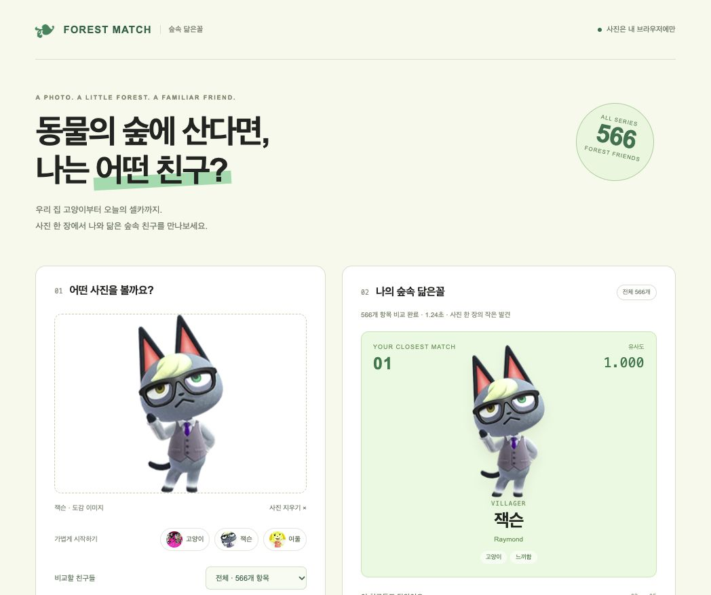

# 숲속 닮은꼴 · Forest Match

사진 한 장으로 나와 닮은 **동물의 숲 캐릭터 TOP 5**를 찾아보세요.
EmbeddingGemma 2가 사진을 벡터로 바꾸고, 도감 속 **566개 캐릭터 이미지**와 비교합니다.

**HTML · CSS · JavaScript · Transformers.js · WebGPU**

선택한 사진은 브라우저 안에서 분석하며, 서버로 업로드하거나 저장하지 않습니다.

## 미리보기



잭슨의 도감 이미지를 넣어 같은 이미지를 찾은 실제 실행 화면입니다. 유사도는 정답 확률이나 외모 점수가 아닙니다.

## 로컬 실행

Python은 필수가 아닙니다. `dist/` 폴더를 localhost 주소로 제공할 **정적 웹서버**가 필요합니다.

아래는 Python 3가 설치된 경우의 실행 예시입니다. 저장소를 내려받은 뒤 프로젝트 루트에서 실행하세요.

```sh
python3 -m http.server 8765 --bind 127.0.0.1 --directory dist
```

브라우저에서 [http://localhost:8765](http://localhost:8765)를 열고 사진을 선택한 뒤 **닮은 친구 찾기**를 누릅니다.

- WebGPU를 사용할 수 있는 브라우저가 필요합니다. Chrome·Edge를 권장하며, **macOS Safari 26.2에서도 실제 실행을 확인**했습니다.
- Safari 검증 환경: **macOS 26.2 / Safari 26.2 (2026-10-12 확인)**. 잭슨·여울·고양이 예시 사진으로 실제 WebGPU 매칭을 확인했습니다. Safari 26.0·26.1 및 iPhone·iPad의 Safari는 직접 테스트하지 않았습니다.
- HTTPS 또는 localhost로 접속해야 합니다. 이 앱은 JavaScript 모듈·Worker·도감 파일 로딩을 사용하므로, HTML을 더블클릭해 `file://`로 여는 방식은 지원하지 않습니다.
- 첫 분석 때 AI 가중치 약 **284MB**와 토크나이저·실행 파일을 다운로드합니다.
- 사진은 **JPG, PNG, WebP / 최대 12MB / 4,000만 픽셀 이하**를 지원합니다. HEIC는 변환이 필요합니다.

Python 대신 다른 정적 웹서버를 사용해도 됩니다. 서버는 파일을 제공하는 역할만 하며, 사진 분석은 브라우저에서 실행됩니다. 배포된 사이트는 주소에 접속하면 되므로 방문자가 Python을 설치할 필요는 없습니다.

## 어떻게 작동하나요?

1. 사진을 흰 배경에 합성하고, 가로·세로 최대 512px로 줄입니다.
2. 브라우저의 Web Worker에서 EmbeddingGemma 2를 WebGPU로 실행합니다.
3. 사진을 **768차원 임베딩 벡터**로 변환합니다.
4. 미리 계산해 둔 캐릭터 이미지 벡터와 **코사인 유사도**를 비교해 상위 5개를 표시합니다.

사진과 도감 이미지에 같은 모델·버전·전처리를 사용합니다. 모델 추론에는 GPU를 사용하고, 전처리·순위 계산 등에는 CPU도 사용합니다.

## 도감 범위

2026년 10월 11일 확인한 Nookipedia 목록을 기준으로 합니다.

| 분류 | 항목 수 |
| --- | ---: |
| 시리즈 전체 일반 주민 | 490 |
| 위 주민 중 모여봐요 3.0 주민 | 417 |
| 특수 캐릭터 | 76 |
| 전체 비교 대상 | **566** |

과거 작품과 콜라보 주민을 포함합니다. 콩돌이·밤돌이는 한 팀으로 표시하고, DJ K.K.·도토리옹·해적은 별도 모습으로 수록했습니다.

정해진 외형이 없는 Player·Parents, 실체 없는 Somebody, 디버그용 Xsq, 미등장·삭제 캐릭터 및 모든 의상별 변형은 포함하지 않습니다. 캐릭터마다 대표 이미지 한 장을 사용하며, 한국어 이름을 확인하지 못한 오래된 캐릭터는 영문으로 표시합니다.
